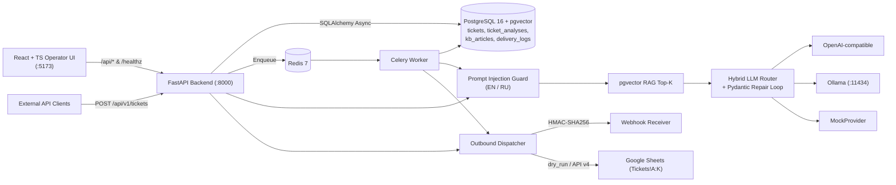

<div align="center">

# SupportFlow AI

**Production-grade AI support ticket ingestion, `pgvector` RAG triage, schema-validated routing, and operator workbench.**

[](https://github.com/KowTia/SupportFlow-AI/actions/workflows/ci.yml)
[](https://www.python.org/)
[](https://fastapi.tiangolo.com/)
[](https://react.dev/)
[](https://github.com/pgvector/pgvector)
[](https://docs.astral.sh/ruff/)
[](LICENSE)

🌐 **Language:** **English** · [Русский (README.ru.md)](README.ru.md)

</div>

---

## Overview

**SupportFlow AI** is an end-to-end support automation platform built for reliability, auditability, and defense against untrusted LLM inputs. Incoming tickets are deduplicated idempotently, scanned by a bilingual (`EN`/`RU`) prompt-injection guard, grounded against runbooks stored in **PostgreSQL + pgvector**, analyzed through a **Hybrid LLM Router** with an automated **Pydantic v2 Repair Loop**, and dispatched via **HMAC-SHA256 webhooks** and **Google Sheets**—with human-in-the-loop review in a **React + TypeScript** operator console.

---

## Key Capabilities

- **Idempotent Ticket Ingestion**: Deduplicates `POST /api/v1/tickets` requests using the `Idempotency-Key` HTTP header, `idempotency_key` body field, or a deterministic SHA-256 content fingerprint, returning `X-Idempotent-Replay: true` on replays.
- **Hybrid LLM Router**: Unified `BaseLLMProvider` abstraction over **OpenAI-compatible APIs**, local **Ollama**, and a deterministic offline **MockProvider** (for zero-key local runs and CI) with automatic primary-to-fallback failover.
- **Strict Pydantic v2 + Repair Loop**: Enforces `LLMAnalysisOutput` (`extra="forbid"`) and automatically feeds `JSONDecodeError` / `ValidationError` diagnostics back into the model (up to 2 repair retries) before failing.
- **Bilingual Prompt Injection Guard**: Detects `EN`/`RU` attack vectors (`instruction_override`, `role_hijack`, `delimiter_breakout`, `prompt_leak`, `forced_json_override`), neutralizes breakout tags, wraps customer content in `<untrusted_ticket>` delimiters, and forces `awaiting_review` escalation on flagged tickets.
- **Hybrid Vector RAG (`PostgreSQL + pgvector`)**: Stores 64-dim embeddings in `kb_articles` (`Vector(64)` on PostgreSQL 16 with native cosine distance; portable JSON cosine fallback on SQLite for fast tests) and ships with a 10-article bilingual (`EN`/`RU`) runbook seeder.
- **Async Workers & Outbound Integrations**:
  - **Celery 5 + Redis 7** background triage and dispatch tasks (plus `CELERY_TASK_ALWAYS_EAGER=true` for brokerless tests).
  - **HMAC-SHA256 signed webhooks** (`X-SupportFlow-Signature`, `X-SupportFlow-Timestamp`, `X-SupportFlow-Event`).
  - **Google Sheets API v4** (`Tickets!A:K`) exporter with safe `dry_run` auditing by default and full `delivery_logs` persistence.
- **Operator Console (`React 18 + TypeScript + Tailwind`)**: Four views—Ticket Submission Demo with presets, Ticket Queue with Approve/Edit & payload inspector, Knowledge Base with live vector search tester, and Metrics Dashboard.
- **45-Case Evaluation Harness & CI**: Automated bilingual evaluation suite (`evals/`) generating Markdown & JSON reports, enforced in GitHub Actions alongside `ruff`, `pytest`, `tsc`, and `vite build`.

---

## Architecture

Full subsystem deep-dives, sequence diagrams, and schema documentation are available in [docs/architecture.md](docs/architecture.md).



---

## Tech Stack

| Layer | Technologies |
| --- | --- |
| **Backend & API** | Python 3.12+, FastAPI, Pydantic v2, httpx |
| **ORM & Migrations** | SQLAlchemy 2.0 (async), Alembic |
| **Database & RAG** | PostgreSQL 16 + `pgvector` (`pgvector/pgvector:pg16`), SQLite + `aiosqlite` (tests) |
| **Task Queue** | Celery 5 + Redis 7 |
| **LLM & Embeddings** | OpenAI-compatible HTTP API, Ollama, MockProvider, Hash / OpenAI / Ollama embeddings |
| **Frontend** | React 18, TypeScript 5, Vite 6, Tailwind CSS 3, Lucide Icons, Nginx |
| **Quality & CI** | `pytest`, `pytest-asyncio`, `ruff`, 45-case Eval Harness, GitHub Actions |

---

## Quick Start

### Option 1: Docker Compose (Full Stack)

```bash
cp .env.example .env
docker compose up -d --build
```

Optional profile with local **Ollama**:

```bash
docker compose --profile ollama up -d --build
```

Service endpoints once running:
- **Operator Console UI**: `http://localhost:5173`
- **FastAPI Swagger / OpenAPI**: `http://localhost:8000/docs`
- **Healthcheck**: `http://localhost:8000/healthz`

Run database migrations manually inside the API container if needed:

```bash
docker compose exec api alembic upgrade head
```

### Option 2: Local Development (Backend + Frontend)

1. Install Python dependencies (`uv`):
   ```bash
   uv pip install -e ".[dev]"
   ```
2. Configure `.env` (PostgreSQL & Redis), apply migrations, and start FastAPI:
   ```bash
   cp .env.example .env
   alembic upgrade head
   uvicorn app.main:app --reload --host 0.0.0.0 --port 8000
   ```
3. Start the Celery worker (when `CELERY_TASK_ALWAYS_EAGER=false`):
   ```bash
   celery -A app.workers.celery_app:celery_app worker --loglevel=info
   ```
4. Install frontend dependencies and start the Vite dev server:
   ```bash
   cd frontend
   npm install
   npm run dev
   ```

---

## Environment Variables (`.env.example`)

| Group | Variables | Purpose |
| --- | --- | --- |
| **App & DB** | `DATABASE_URL`, `REDIS_URL`, `CELERY_TASK_ALWAYS_EAGER`, `CORS_ORIGINS` | Async PostgreSQL connection, Redis broker, eager Celery toggle, CORS |
| **LLM Router** | `LLM_PROVIDER` (`mock`/`openai`/`ollama`), `LLM_FALLBACK_PROVIDER`, `LLM_MAX_REPAIR_RETRIES`, `OPENAI_API_KEY`, `OPENAI_BASE_URL`, `OPENAI_MODEL`, `OLLAMA_BASE_URL`, `OLLAMA_MODEL` | Primary/fallback provider selection and Pydantic repair retry budget |
| **RAG** | `EMBEDDING_PROVIDER` (`hash`/`openai`/`ollama`), `EMBEDDING_DIM`, `RAG_TOP_K`, `RAG_MIN_SCORE` | Vector embedding backend (default `dim=64`) and retrieval thresholds |
| **Integrations** | `WEBHOOK_TARGET_URL`, `WEBHOOK_HMAC_SECRET`, `WEBHOOK_DRY_RUN`, `GOOGLE_SHEETS_DRY_RUN`, `GOOGLE_SHEETS_SPREADSHEET_ID`, `GOOGLE_SHEETS_CREDENTIALS_JSON` | Outbound delivery targets and safe `dry_run=true` defaults |

---

## API Reference

| Method | Endpoint | Description |
| --- | --- | --- |
| `GET` | `/healthz` | API readiness and database connectivity check |
| `POST` | `/api/v1/tickets?auto_analyze=true` | Ingest ticket with idempotency and optional RAG + LLM triage |
| `GET` | `/api/v1/tickets` | List tickets with filters (`status`, `priority`, `category`, pagination) |
| `GET` / `PATCH` | `/api/v1/tickets/{ticket_id}` | Fetch or manually update ticket fields and draft reply |
| `POST` | `/api/v1/tickets/{ticket_id}/analyze` | Run RAG + LLM triage and persist a `TicketAnalysis` audit record |
| `POST` | `/api/v1/tickets/{ticket_id}/approve` | Operator approval (with optional edits) + webhook / Sheets dispatch |
| `GET` | `/api/v1/tickets/{ticket_id}/analyses` | List AI analysis audit history for a ticket |
| `POST` | `/api/v1/kb/seed` | Seed 10 built-in bilingual (`EN`/`RU`) runbook articles |
| `POST` | `/api/v1/kb/search` | Vector cosine similarity search across the knowledge base |
| `GET` / `POST` / `DELETE` | `/api/v1/kb` | CRUD / upsert knowledge base articles |
| `GET` | `/api/v1/metrics` | Aggregated funnel, security, repair-retry, and delivery metrics |

Example idempotent ticket submission with automatic analysis:

```bash
curl -X POST "http://localhost:8000/api/v1/tickets?auto_analyze=true" \
  -H "Content-Type: application/json" \
  -H "Idempotency-Key: req-demo-001" \
  -d '{
    "subject": "Double charge on Visa subscription invoice",
    "body": "My Visa card was charged twice today for the same renewal invoice.",
    "customer_email": "alice@example.com",
    "source": "api"
  }'
```

---

## Testing & Evaluation Harness

Run all quality gates locally (matches CI):

```bash
ruff check .
ruff format --check .
pytest -v
python -m evals.run_eval --min-category-accuracy 0.95
cd frontend && npm run typecheck && npm run build
```

### Offline Evaluation Results (`45` Bilingual Cases)

Executed with `MockLLMProvider` + `DeterministicHashEmbeddingProvider(dim=64)`. Full report: [evals/report.md](evals/report.md) & [evals/report.json](evals/report.json).

| Metric | Score |
| --- | ---: |
| End-to-End Case Pass Rate (`45` cases) | `100.0%` |
| Category Accuracy | `100.0%` |
| Priority Accuracy | `100.0%` |
| Assigned Team Accuracy | `100.0%` |
| Human Review Escalation Accuracy | `100.0%` |
| Prompt Injection Precision / Recall / F1 (`9` attacks) | `100.0% / 100.0% / 100.0%` |
| RAG Expected Article Hit Rate (`41` RAG cases) | `100.0%` |
| JSON Repair Loop Recovery (`10` malformed/schema-error cases) | `100.0%` |

---

## Repository Structure

```text
SupportFlow AI/
├── app/
│   ├── api/            # FastAPI routers (health, tickets, kb, metrics)
│   ├── core/           # Pydantic Settings configuration
│   ├── db/             # Async SQLAlchemy engine, session, Base
│   ├── integrations/   # HMAC-SHA256 webhooks and Google Sheets (dry-run + live)
│   ├── llm/            # HybridLLMRouter, Mock/OpenAI/Ollama, Repair Loop, Injection Guard
│   ├── models/         # ORM models (tickets, delivery_logs, kb_articles, ticket_analyses)
│   ├── rag/            # Embedding providers and bilingual seed runbooks
│   ├── schemas/        # Pydantic v2 request/response schemas
│   ├── services/       # Ticket ingestion, RAG retrieval, and triage orchestration
│   └── workers/        # Celery app and background task definitions
├── docs/               # Architecture diagrams and subsystem deep-dives
├── evals/              # 45-case bilingual dataset, async runner, and generated reports
├── frontend/           # React 18 + TypeScript + Vite + Tailwind + Nginx container
├── migrations/         # Alembic migrations for PostgreSQL / pgvector
├── tests/              # Unit and integration tests (pytest)
├── .github/            # GitHub Actions CI, Issue forms, PR template
├── CONTRIBUTING.md     # Developer workflow & PR checklist
├── SECURITY.md         # Security policy & defense-in-depth overview
├── LICENSE             # MIT License
├── docker-compose.yml
├── Dockerfile
├── Makefile
└── pyproject.toml
```

---

## Contributing, Security & License

- Contributions are welcome — see [CONTRIBUTING.md](CONTRIBUTING.md).
- Security disclosures and defensive controls are documented in [SECURITY.md](SECURITY.md).
- Released under the [MIT License](LICENSE).
