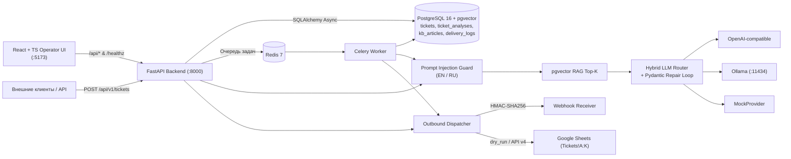

<div align="center">

# SupportFlow AI

**Платформа приёма, RAG-анализа на `pgvector`, строгой валидации и маршрутизации обращений в поддержку с панелью оператора.**

[](https://github.com/KowTia/SupportFlow-AI/actions/workflows/ci.yml)
[](https://www.python.org/)
[](https://fastapi.tiangolo.com/)
[](https://react.dev/)
[](https://github.com/pgvector/pgvector)
[](https://docs.astral.sh/ruff/)
[](LICENSE)

🌐 **Язык:** [English (README.md)](README.md) · **Русский**

</div>

---

## О проекте

**SupportFlow AI** — полноценная платформа автоматизации службы поддержки, спроектированная с фокусом на надёжность, аудит и защиту от небезопасного пользовательского ввода. Входящие тикеты проходят идемпотентную дедупликацию, проверяются двуязычным (`EN`/`RU`) детектором prompt injection, обогащаются контекстом из базы знаний на **PostgreSQL + pgvector**, анализируются через **гибридный LLM-роутер** с циклом автоисправления схем **Pydantic v2** и отправляются во внешние системы через **HMAC-SHA256 вебхуки** и **Google Sheets** с контролем оператора в веб-консоли на **React + TypeScript**.

---

## Ключевые возможности

- **Идемпотентный приём обращений**: дедупликация запросов `POST /api/v1/tickets` по заголовку `Idempotency-Key`, полю `idempotency_key` или SHA-256 отпечатку содержимого с возвратом `X-Idempotent-Replay: true`.
- **Гибридный LLM-роутер**: единый интерфейс `BaseLLMProvider` для **OpenAI-compatible API**, локальной **Ollama** и детерминированного **MockProvider** (для офлайн-разработки и CI) с автоматическим fallback.
- **Strict Pydantic v2 + Repair Loop**: строгая схема `LLMAnalysisOutput` (`extra="forbid"`) и цикл автоисправления невалидного JSON / ошибок валидации (до 2 повторных попыток с передачей точного `ValidationError`).
- **Защита от Prompt Injection**: двуязычный (`EN`/`RU`) детектор атак (`instruction_override`, `role_hijack`, `delimiter_breakout`, `prompt_leak`, `forced_json_override`), экранирование тегов, изоляция внутри `<untrusted_ticket>` и принудительный перевод подозрительных тикетов в статус `awaiting_review`.
- **Векторный RAG на `PostgreSQL + pgvector`**: хранение 64-мерных эмбеддингов в `kb_articles` (`Vector(64)` на PostgreSQL 16 с нативным косинусным поиском и JSON-fallback на SQLite для локальных тестов), встроенный сидер из 10 RU/EN runbook-статей.
- **Celery + Redis и исходящие интеграции**:
  - Фоновая обработка и доставка задач через **Celery 5 + Redis 7** (поддерживается `CELERY_TASK_ALWAYS_EAGER=true` для тестов без брокера).
  - Вебхуки с подписью **HMAC-SHA256** (`X-SupportFlow-Signature`, `X-SupportFlow-Timestamp`, `X-SupportFlow-Event`) и поддержкой `dry_run`.
  - Экспорт тикетов в **Google Sheets API v4** (`Tickets!A:K`) с безопасным режимом `dry_run` по умолчанию и полным аудитом в `delivery_logs`.
- **Панель оператора (`React 18 + TypeScript + Tailwind`)**: 4 экрана — Демо-форма с пресетами, Очередь тикетов с Approve/Edit и инспектором payload'ов, База знаний с тестером векторного поиска и Дашборд метрик.
- **45-кейсовый Eval Harness & CI**: двуязычный набор тестов (`evals/`) с автогенерацией Markdown/JSON-отчётов и проверками `ruff`, `pytest`, `tsc` и `vite build` в GitHub Actions.

---

## Архитектура

Подробное описание подсистем, диаграммы последовательности и схема базы данных приведены в [docs/architecture.md](docs/architecture.md).



---

## Стек технологий

| Слой | Технологии |
| --- | --- |
| **Backend & API** | Python 3.12+, FastAPI, Pydantic v2, httpx |
| **ORM и миграции** | SQLAlchemy 2.0 (async), Alembic |
| **База данных и RAG** | PostgreSQL 16 + `pgvector` (`pgvector/pgvector:pg16`), SQLite + `aiosqlite` (тесты) |
| **Очередь задач** | Celery 5 + Redis 7 |
| **LLM и эмбеддинги** | OpenAI-compatible HTTP API, Ollama, MockProvider, Hash / OpenAI / Ollama embeddings |
| **Frontend** | React 18, TypeScript 5, Vite 6, Tailwind CSS 3, Lucide Icons, Nginx |
| **Качество и CI** | `pytest`, `pytest-asyncio`, `ruff`, 45-кейсовый Eval Harness, GitHub Actions |

---

## Быстрый старт

### Вариант 1: Docker Compose (полный стек)

```bash
cp .env.example .env
docker compose up -d --build
```

Опциональный профиль с локальной **Ollama**:

```bash
docker compose --profile ollama up -d --build
```

После запуска сервисы доступны по адресам:
- **Панель оператора (UI)**: `http://localhost:5173`
- **FastAPI Swagger / OpenAPI**: `http://localhost:8000/docs`
- **Healthcheck**: `http://localhost:8000/healthz`

При необходимости применить миграции вручную внутри контейнера API:

```bash
docker compose exec api alembic upgrade head
```

### Вариант 2: Локальная разработка (Backend + Frontend)

1. Установить Python-зависимости (`uv`):
   ```bash
   uv pip install -e ".[dev]"
   ```
2. Настроить `.env` (PostgreSQL и Redis), применить миграции и запустить API:
   ```bash
   cp .env.example .env
   alembic upgrade head
   uvicorn app.main:app --reload --host 0.0.0.0 --port 8000
   ```
3. Запустить Celery-воркер (если `CELERY_TASK_ALWAYS_EAGER=false`):
   ```bash
   celery -A app.workers.celery_app:celery_app worker --loglevel=info
   ```
4. Установить зависимости и запустить Vite dev-сервер для UI:
   ```bash
   cd frontend
   npm install
   npm run dev
   ```

---

## Переменные окружения (`.env.example`)

| Группа | Переменные | Описание |
| --- | --- | --- |
| **App & DB** | `DATABASE_URL`, `REDIS_URL`, `CELERY_TASK_ALWAYS_EAGER`, `CORS_ORIGINS` | Подключение к PostgreSQL, брокер Redis, eager-режим Celery, CORS |
| **LLM Router** | `LLM_PROVIDER` (`mock`/`openai`/`ollama`), `LLM_FALLBACK_PROVIDER`, `LLM_MAX_REPAIR_RETRIES`, `OPENAI_API_KEY`, `OPENAI_BASE_URL`, `OPENAI_MODEL`, `OLLAMA_BASE_URL`, `OLLAMA_MODEL` | Выбор основного/резервного провайдера и лимит ретраев Repair Loop |
| **RAG** | `EMBEDDING_PROVIDER` (`hash`/`openai`/`ollama`), `EMBEDDING_DIM`, `RAG_TOP_K`, `RAG_MIN_SCORE` | Провайдер эмбеддингов (по умолчанию `dim=64`) и порог релевантности |
| **Integrations** | `WEBHOOK_TARGET_URL`, `WEBHOOK_HMAC_SECRET`, `WEBHOOK_DRY_RUN`, `GOOGLE_SHEETS_DRY_RUN`, `GOOGLE_SHEETS_SPREADSHEET_ID`, `GOOGLE_SHEETS_CREDENTIALS_JSON` | Параметры доставки и безопасный режим `dry_run=true` по умолчанию |

---

## Основные API-эндпоинты

| Метод | Путь | Назначение |
| --- | --- | --- |
| `GET` | `/healthz` | Проверка готовности API и соединения с БД |
| `POST` | `/api/v1/tickets?auto_analyze=true` | Создание тикета с идемпотентностью и опциональным RAG + LLM анализом |
| `GET` | `/api/v1/tickets` | Список тикетов с фильтрами (`status`, `priority`, `category`, пагинация) |
| `GET` / `PATCH` | `/api/v1/tickets/{ticket_id}` | Просмотр тикета и ручное обновление полей / черновика ответа |
| `POST` | `/api/v1/tickets/{ticket_id}/analyze` | Запуск RAG + LLM триажа и сохранение записи `TicketAnalysis` |
| `POST` | `/api/v1/tickets/{ticket_id}/approve` | Подтверждение оператором (с правками) и отправка вебхука / Sheets |
| `GET` | `/api/v1/tickets/{ticket_id}/analyses` | История AI-анализов по тикету |
| `POST` | `/api/v1/kb/seed` | Загрузка 10 встроенных RU/EN статей базы знаний |
| `POST` | `/api/v1/kb/search` | Семантический векторный поиск по базе знаний |
| `GET` / `POST` / `DELETE` | `/api/v1/kb` | CRUD / upsert статей базы знаний |
| `GET` | `/api/v1/metrics` | Агрегированные метрики воронки, безопасности, ретраев и доставок |

Пример запроса на создание тикета с идемпотентностью и автоанализом:

```bash
curl -X POST "http://localhost:8000/api/v1/tickets?auto_analyze=true" \
  -H "Content-Type: application/json" \
  -H "Idempotency-Key: req-demo-001" \
  -d '{
    "subject": "Double charge on Visa subscription invoice",
    "body": "My Visa card was charged twice today for the same renewal invoice.",
    "customer_email": "alice@example.com",
    "source": "api"
  }'
```

---

## Тесты и Evaluation Harness

Запуск всех проверок локально (идентично CI):

```bash
ruff check .
ruff format --check .
pytest -v
python -m evals.run_eval --min-category-accuracy 0.95
cd frontend && npm run typecheck && npm run build
```

### Результаты Eval Harness (`45` двуязычных кейсов)

Офлайн-профиль: `MockLLMProvider` + `DeterministicHashEmbeddingProvider(dim=64)`. Полный отчёт: [evals/report.md](evals/report.md) и [evals/report.json](evals/report.json).

| Метрика | Значение |
| --- | ---: |
| End-to-End Case Pass Rate (`45` кейсов) | `100.0%` |
| Category Accuracy | `100.0%` |
| Priority Accuracy | `100.0%` |
| Assigned Team Accuracy | `100.0%` |
| Human Review Escalation Accuracy | `100.0%` |
| Prompt Injection Precision / Recall / F1 (`9` атак) | `100.0% / 100.0% / 100.0%` |
| RAG Expected Article Hit Rate (`41` RAG-кейс) | `100.0%` |
| JSON Repair Loop Recovery (`10` кейсов со сбоями JSON/схемы) | `100.0%` |

---

## Структура репозитория

```text
SupportFlow AI/
├── app/
│   ├── api/            # FastAPI роутеры (health, tickets, kb, metrics)
│   ├── core/           # Pydantic Settings и конфигурация
│   ├── db/             # Async SQLAlchemy engine, session, Base
│   ├── integrations/   # HMAC-SHA256 вебхуки и Google Sheets (dry-run + live)
│   ├── llm/            # HybridLLMRouter, Mock/OpenAI/Ollama, Repair Loop, Injection Guard
│   ├── models/         # ORM модели (tickets, delivery_logs, kb_articles, ticket_analyses)
│   ├── rag/            # Эмбеддинги и seed-данные базы знаний
│   ├── schemas/        # Pydantic v2 API-схемы
│   ├── services/       # Бизнес-логика тикетов, RAG-поиска и триажа
│   └── workers/        # Celery приложение и фоновые задачи
├── docs/               # Архитектурная документация (architecture.md)
├── evals/              # 45-кейсовый датасет, async-раннер и автоотчёты
├── frontend/           # React 18 + TypeScript + Vite + Tailwind + Nginx Dockerfile
├── migrations/         # Alembic миграции PostgreSQL / pgvector
├── tests/              # Unit и интеграционные тесты (pytest)
├── .github/            # GitHub Actions CI, шаблоны Issue и PR
├── CONTRIBUTING.md     # Руководство для контрибьюторов
├── SECURITY.md         # Политика безопасности и защитные механизмы
├── LICENSE             # Лицензия MIT
├── docker-compose.yml
├── Dockerfile
├── Makefile
└── pyproject.toml
```

---

## Вклад в проект, безопасность и лицензия

- Порядок разработки и чеклист перед PR описаны в [CONTRIBUTING.md](CONTRIBUTING.md).
- Описание защитных механизмов и порядок сообщения об уязвимостях — в [SECURITY.md](SECURITY.md).
- Проект распространяется под лицензией [MIT](LICENSE).
