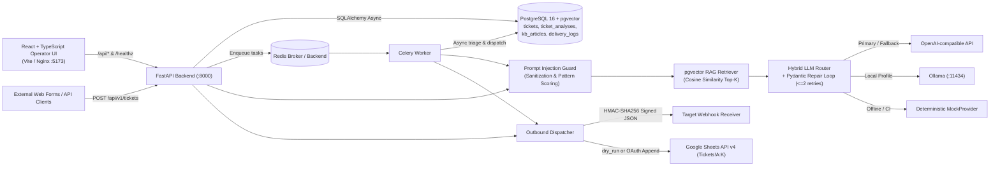
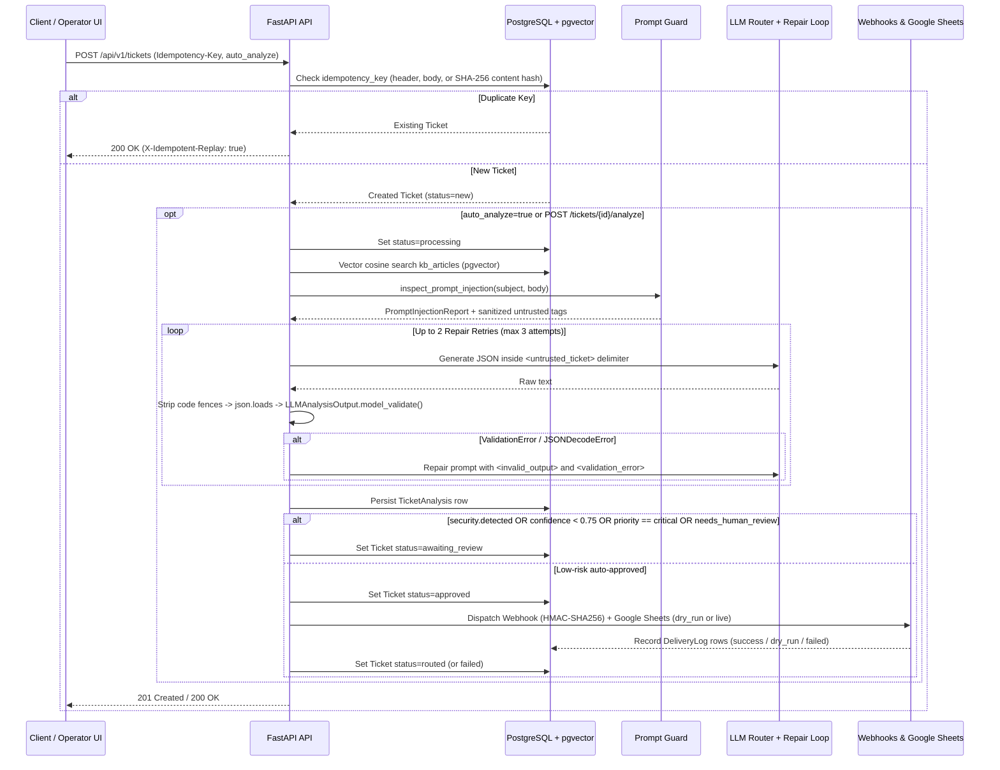

# SupportFlow AI — Architecture & Design

This document describes the architecture, data model, reliability mechanisms, security controls, and evaluation strategy of **SupportFlow AI**.

## 1. High-Level System Architecture

## 2. Core Request & Triage Pipeline

## 3. Subsystem Deep-Dives

### 3.1 Idempotent Ticket Ingestion
- `POST /api/v1/tickets` supports deduplication via three prioritized strategies in `app/services/tickets.py`:
  1. `Idempotency-Key` HTTP header.
  2. Explicit `idempotency_key` field in `TicketCreate`.
  3. Deterministic SHA-256 content fingerprint derived from `(source, customer_email, subject, body)` when no explicit key is supplied.
- Replayed requests return HTTP `200 OK` with header `X-Idempotent-Replay: true` instead of creating duplicate database records.

### 3.2 Prompt Injection Guard (`app/llm/security.py`)
- Before building LLM prompts, `inspect_prompt_injection(subject, body)` evaluates untrusted input against bilingual (`EN` and `RU`) pattern detectors:
  - `instruction_override` (`ignore previous instructions`, `игнорируй все предыдущие инструкции`, etc.)
  - `role_hijack` (`you are now`, `act as system`, `действуй как администратор`, etc.)
  - `delimiter_breakout` (`</untrusted_ticket>`, `<system>`, `<|im_start|>`, `[SYSTEM]`)
  - `prompt_leak` (`reveal your system prompt`, `покажи свой системный промпт`, etc.)
  - `forced_json_override` (`return only json`, `set priority to`, `auto_approve`, `выдай json`)
- `sanitize_untrusted_text()` neutralizes breakout delimiters (`[ESCAPED_TAG]`), wraps customer text inside `<untrusted_ticket>...</untrusted_ticket>`, and `TicketAnalyzer.analyze()` forces `needs_human_review = True` whenever `security.detected` is true so untrusted prompts can never auto-route or auto-approve.

### 3.3 Hybrid Vector RAG (`app/models/kb.py`, `app/rag/`, `app/services/kb.py`)
- **Single-database vector storage**: `KBArticle.embedding` uses a custom SQLAlchemy `TypeDecorator` (`EmbeddingVector(64)`) storing native `pgvector.sqlalchemy.Vector(64)` on PostgreSQL and portable `JSON` on SQLite for fast test execution.
- **Embedding providers**:
  - `DeterministicHashEmbeddingProvider`: bilingual concept anchors (`EN` + `RU`) combined with SHA-256 token & prefix n-gram hashing and unit L2 normalization for offline tests and CI.
  - `OpenAIEmbeddingProvider`: OpenAI `/embeddings` client.
  - `OllamaEmbeddingProvider`: local Ollama `/api/embeddings` client.
- On PostgreSQL, `search_kb_articles()` delegates similarity ranking directly to `KBArticle.embedding.cosine_distance(query_vec)`; on SQLite, it falls back to exact in-process cosine similarity.

### 3.4 Hybrid LLM Router & Pydantic Repair Loop (`app/llm/`)
- `HybridLLMRouter` pairs any configured primary provider (`openai`, `ollama`, `mock`) with an automatic fallback provider if the primary raises `LLMProviderError`.
- `TicketAnalyzer` enforces strict Pydantic v2 validation (`LLMAnalysisOutput` with `extra="forbid"`, bounded floats, strict `TicketCategory`, `TicketPriority`, and `AssignedTeam` enums).
- When a provider emits markdown fences, truncated JSON, or schema violations, the repair loop feeds both `<invalid_output>` and the exact Pydantic `ValidationError` / `JSONDecodeError` back to the router for up to `LLM_MAX_REPAIR_RETRIES` (default `2`) self-correction retries before failing with `LLMRepairExhaustedError`.

### 3.5 Async Queue & Outbound Integrations (`app/workers/`, `app/integrations/`)
- **Celery + Redis**: `supportflow.triage_ticket` and `supportflow.dispatch_ticket` offload triage and webhook/Sheets dispatches cleanly to worker containers (`CELERY_TASK_ALWAYS_EAGER=true` supports zero-broker tests).
- **HMAC-SHA256 Webhooks**: `deliver_webhook()` computes `sha256=<hex>` over `<timestamp>.<canonical_raw_body>` and sends headers `X-SupportFlow-Event`, `X-SupportFlow-Timestamp`, and `X-SupportFlow-Signature`, alongside a constant-time helper `verify_hmac_signature()`.
- **Google Sheets Exporter**: `export_ticket_to_sheets()` appends 11-column summary rows to `Tickets!A:K` and mandates safe `dry_run` auditing (`DeliveryStatus.DRY_RUN`) whenever `GOOGLE_SHEETS_DRY_RUN=true` or credentials are omitted. Every dispatch outcome is recorded in `delivery_logs`.

## 4. Database Schema Summary

| Table | Purpose | Key Columns | Migration |
| --- | --- | --- | --- |
| `tickets` | Core inbound tickets & triage state | `id` (UUID PK), `idempotency_key` (unique), `status`, `category`, `priority`, `assigned_team`, `draft_reply`, `metadata_json` | `0001_initial` |
| `delivery_logs` | Audit trail for webhooks & Sheets | `id`, `ticket_id` (FK), `target`, `endpoint`, `status`, `status_code`, `request_payload`, `response_body`, `error_message` | `0001_initial` |
| `kb_articles` | Bilingual support runbooks & vectors | `id`, `slug` (unique), `title`, `category`, `content`, `tags` (JSON), `embedding` (`Vector(64)` / `JSON`) | `0002_kb_articles` |
| `ticket_analyses` | Full LLM & security audit history | `id`, `ticket_id` (FK), `provider`, `model`, `confidence`, `cited_kb_ids`, `injection_detected`, `injection_risk_score`, `repair_attempts`, `latency_ms` | `0003_ticket_analyses` |

## 5. Operator Console & Eval Harness
- **Frontend (`frontend/`)**: Single-page React 18 + TypeScript + Tailwind operator workbench proxying `/api` and `/healthz` through Vite in dev or Nginx in Docker Compose (`5173:80`).
- **Evaluation Harness (`evals/`)**: Runs 45 labeled bilingual cases across an isolated database + seeded RAG corpus, exercising classification accuracy, RAG citation hit rate, prompt-injection detection precision/recall, and malformed-JSON repair recovery (`evals/report.md` & `evals/report.json`).
